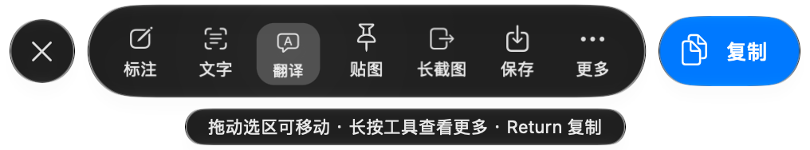
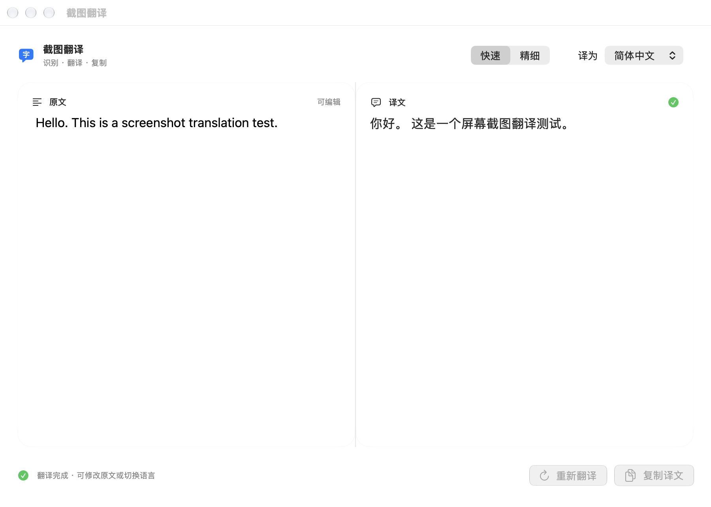

# ShotKit macOS

**把截图、文字识别和翻译放到一个轻巧的原生工具栏里。**

[English](docs/README.en.md) · [MIT License](LICENSE) · 当前版本 **4.2.0**

ShotKit 是为 Apple Silicon Mac 制作的截图工具，由 **Hammerspoon + Swift / AppKit / SwiftUI** 驱动。它使用系统 Liquid Glass 材质、SF Symbols 和 Translation，提供轻量交互反馈。**目前依赖 Hammerspoon，不是独立启动的截图 App。**



## 能做什么

- **智能选区**：窗口与辅助功能元素识别，边框过滤、选区稳定处理；也可拖动自由框选、移动和调整大小。
- **标注**：箭头、方框、画笔、文字、遮盖、马赛克、裁剪、撤销与重做。
- **本机文字识别与读码**：可编辑的识别结果、复制、TXT 导出；二维码仅显示内容，不自动打开链接。
- **系统翻译**：后台识别，快速／精细模式，目标语言切换、停止、重试、结果缓存与复制反馈。
- **贴图与历史**：截图置顶、缩放，原生缩略图历史，搜索已识别的文字。
- **逐段长截图**：手动滚动并截取相互重叠的分段，拼接后进入编辑器检查。
- **交互反馈**：悬停微浮起、按下收缩与高亮、松开回弹、拖出取消；长按或右键显示快捷菜单。
- **系统适配**：深浅色、减弱动态效果、系统保存对话框和键盘操作。

## 运行要求

- **Apple Silicon，macOS 15 或更新版本**。当前发行包仅提供 arm64。
- [Hammerspoon](https://www.hammerspoon.org/)，以及 Python 3（安装脚本使用）。
- macOS 26+ 显示原生 Liquid Glass；更早版本使用系统材质回退。macOS 27 增强玻璃交互。
- “快速／精细”翻译方式需要 macOS 26.4+；首次使用某组语言时，系统可能要求下载语言包。
- **源码编译**需要包含 **macOS 27 SDK** 的 Apple 开发工具。普通使用可选择发行包。

## 安装

### 使用发行包

1. 从本仓库 **Releases** 下载 `shotkit-macos-v4.2.0-arm64.zip` 并解压。可对照同一 Release 的 `SHA256SUMS.txt` 校验文件。
2. 先安装并打开 Hammerspoon，退出正在进行的截图或编辑操作。
3. 在解压目录执行：

   ```sh
   python3 scripts/install.py --dry-run
   python3 scripts/install.py
   ```

4. 在 Hammerspoon 菜单中选择 **Reload Config**。
5. 根据系统提示，为 Hammerspoon 开启 **辅助功能**和**屏幕录制**权限，必要时重新启动 Hammerspoon。

安装器只更新四个截图 Lua 模块、`ShotKit.app`，并在需要时向现有 `init.lua` 添加启动语句。已有配置和相关文件会备份到配置目录的 `.shotkit-backups/`，不会自动重载或覆盖其他模块。

发行包采用临时签名，**尚未经过 Apple 公证**。如果系统拦截，请按 macOS 官方方式核验和允许，或选择本机源码编译；本项目不会自动移除隔离标记或关闭系统安全检查。

如果 `init.lua` 是符号链接，或想手动管理配置：

```sh
python3 scripts/install.py --no-init
```

然后在自己的配置中加入：

```lua
require("screenshot").start()
```

自定义配置目录使用 `--config /path/to/hammerspoon`。

### 源码编译

```sh
zsh build.sh
python3 scripts/install.py --dry-run
python3 scripts/install.py
```

构建产物位于 `build/ShotKit.app`。本仓库不提交编译产物，预编译程序只随 Release 提供。

## 怎么用

| 操作 | 快捷键／方式 |
| --- | --- |
| 开始截图 | Control + Command + A |
| 打开历史／结束长截图 | Shift + Control + Command + A |
| 复制选区 | Return、双击选区或“复制”按钮 |
| 取消 | Esc |
| 标注／提取文字／翻译／贴图 | E / O / T / P |
| 保存／长截图／延时截图 | S / L / D |
| 微调位置／尺寸 | 方向键 / Shift + 方向键；Option 加速 |
| 更多操作 | 长按约 0.45 秒或右键点击工具；翻译可直接选目标语言 |
| 翻译窗口：重新翻译／停止／复制 | Command + Return / Esc / Shift + Command + C |



逐段长截图需要手动滚动，建议保留至少三分之一重叠；它不是自动滚动整页截图。默认最多 20 段，最终进入编辑器检查。

## 性能与隐私

常驻服务处理原生工具栏、辅助功能查询、文字识别和翻译，避免每次操作反复启动识别程序。工具启动后会后台准备识别组件；识别与读码分开执行。拖动和缩放直接跟随鼠标，选区闲置后停止更新定时器。

在一台 Apple Silicon Mac 上，后台准备完成后的 800 × 160 合成英文图测试中，窗口约 **114 ms** 显示，识别到译文完成约 **730 ms**，重复翻译约 **9–13 ms**。这些是单机测量，**不包含截屏耗时，也不是性能保证**；冷启动、文字量、模型准备和语言下载都会影响时间。

- 截图、缩略图、识别文字及历史元数据保存在 Hammerspoon 配置目录的 `screenshot-data/`，不上传到项目服务器。
- 默认保留最近 60 张，按 30 天、300 MB 清理；长截图临时分段保留约 24 小时。菜单可调整历史数量。
- 识别文字与译文的运行时缓存各限约 2 MB、分别最多 24／48 条，退出服务后清空。
- 翻译调用 Apple 系统 Translation，语言资源由系统管理；本项目没有第三方翻译 API、分析统计或账户体系。
- “复制并打开 ChatGPT”只复制截图并打开本机应用，**不会替你粘贴或发送**。
- 遮盖和马赛克会写入导出的图片，但**历史中的原图仍然保留**。分享敏感截图前请检查导出内容。
- 仓库内的图片全部为合成示例，不含用户截图或历史记录。

## 恢复上一版本

退出正在使用的截图／编辑窗口后：

```sh
python3 scripts/install.py --uninstall --dry-run
python3 scripts/install.py --uninstall
```

再选择 Hammerspoon → Reload Config。截图历史和备份保留。如果安装后修改过模块，恢复脚本会停止以保护修改；对后来加入的其他 `init.lua` 配置也会尽量保留。

## 开发与测试

```sh
python3 -m unittest discover -s tests -p 'test_*.py' -v
sh scripts/test.sh  # 完整执行还需 Lua 5.4+
```

原生图片处理测试需在本机编译后运行，只生成合成图片：

```sh
build/ShotKit.app/Contents/MacOS/ShotKit selftest /tmp/shotkit-selftest
```

测试覆盖安装／恢复、选区过滤与边框稳定、闲置画布更新、OCR、二维码、分段拼接、重复分段拒绝、不透明遮盖和裁剪。真实交互、权限、多显示器和语言下载仍需要在 Mac 上人工验证。

源文件位于 `lua/` 和 `native/`。欢迎提交复现步骤、改进建议和 PR，详见 [CONTRIBUTING](CONTRIBUTING.md)。

## 许可证与致谢

[MIT](LICENSE)。感谢 [Hammerspoon](https://www.hammerspoon.org/)。Apple、macOS、Liquid Glass 和 SF Symbols 是各自权利人的名称／技术；本项目是独立社区项目，与 Apple、QQ 或 Hammerspoon 官方无隶属关系。
